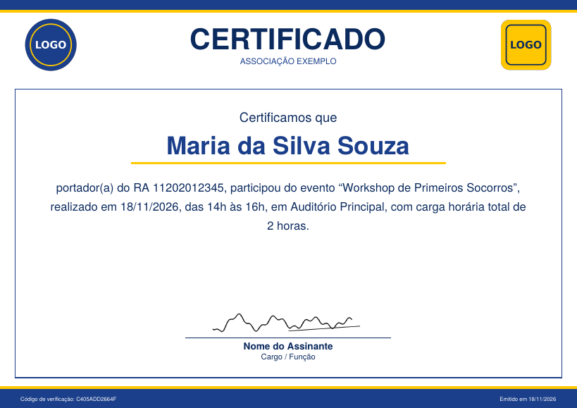
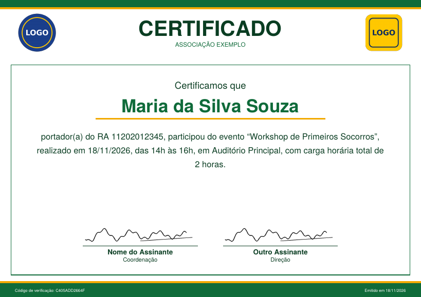

# 🎓 Gerador de Certificados

Gere certificados em PDF a partir de uma planilha e envie cada um por e-mail automaticamente.
Pensado para eventos, aulas, workshops e palestras: você coleta as inscrições (por exemplo, num Google Forms),
joga a planilha na ferramenta e, com alguns cliques, todo mundo recebe o seu certificado.

> *English summary:* open-source tool that turns a spreadsheet (`.xlsx`/`.csv`) into personalized PDF
> certificates and e-mails them via SMTP. Fully customizable (colors, logos, signatures, texts) through a web UI
> (Streamlit) or a JSON config. Documentation is in Portuguese.

| Tema azul | Tema verde (2 assinaturas) |
|---|---|
|  |  |

## ✨ Recursos

- **Planilha flexível:** aceita `.xlsx` e `.csv`; reconhece as colunas pelo nome (qualquer ordem, colunas extras são ignoradas) — funciona direto com exportações do Google Forms.
- **Personalização pela interface:** cores, logos (escolha o lado e o tamanho), até 3 assinaturas, todos os textos do certificado e do e-mail.
- **Campo de identificação opcional:** RA, matrícula, RG, CPF… ou nenhum. Você escolhe qual coluna usar e o rótulo exibido; se estiver vazio para alguém, o certificado sai sem essa frase.
- **Prévia em tempo real** do certificado enquanto você edita.
- **Envio seguro por e-mail (SMTP):** botão de **teste para você mesmo** antes do envio real, pausa entre mensagens e registro em `log_envios.csv`. Se rodar de novo, quem já recebeu é pulado.
- **Padroniza nomes** (`JOÃO DA SILVA` → `João da Silva`) e ignora e-mails inválidos e duplicados.
- **Código de verificação** opcional no rodapé de cada certificado.
- Funciona pela **interface web** ou pela **linha de comando**.

## 📋 Requisitos

- Python **3.9 ou superior** (https://www.python.org/downloads/ — no Windows, marque *Add Python to PATH*).
- Uma conta de e-mail com SMTP habilitado (Gmail com *senha de app*, por exemplo) — só para o envio. Gerar PDFs não exige conta.

## 🚀 Instalação

```bash
git clone https://github.com/welbertfilho9/gerador-certificados.git
cd gerador-certificados

# (recomendado) ambiente virtual
python -m venv .venv
# Windows:   .venv\Scripts\activate
# Mac/Linux: source .venv/bin/activate

pip install -r requirements.txt
```

## ▶️ Como usar

### Pela interface (recomendado)

```bash
python -m streamlit run app.py
```

O navegador abre em `http://localhost:8501` com três abas:

1. **Evento e textos** – nome, data, horário, local, carga horária, textos do certificado e do e-mail.
2. **Visual** – cores, logos, assinaturas.
3. **Planilha e envio** – envie a planilha, escolha o campo de identificação (opcional), gere os PDFs, mande um teste para você e, por fim, envie para todos.

A prévia fica na barra lateral. Clique em **💾 Salvar configurações** para guardar tudo em `config.json`
(assim você não precisa refazer na próxima vez).

### Pela linha de comando

```bash
python -m certgen planilha.xlsx                       # só gera os PDFs
python -m certgen planilha.xlsx --coluna-id "RA"      # usando a coluna RA como identificação
python -m certgen planilha.xlsx --enviar              # gera e envia por e-mail
python -m certgen planilha.xlsx --config outro.json   # usa outro arquivo de configuração
```

Os PDFs ficam em `saida/certificados/` e o registro de envios em `saida/log_envios.csv`.

## 📊 Formato da planilha

Não há ordem fixa de colunas. São necessárias **uma coluna de nome** e **uma de e-mail**, identificadas pelo cabeçalho
(sem diferenciar maiúsculas/acentos):

| Campo | Cabeçalhos aceitos (exemplos) |
|---|---|
| Nome | `Nome`, `Nome completo`, `Aluno`, `Participante` |
| E-mail | `Email`, `E-mail`, `Endereço de e-mail` (e variações) |

Qualquer outra coluna (carimbo de data/hora, curso, RA…) é ignorada, **a menos que** você a escolha como campo de identificação.

- Se houver duas colunas de e-mail (ex.: pessoal e institucional), o padrão é usar a que **não** contém “institucional”. Para escolher a outra, defina `"planilha": {"coluna_email": "institucional"}` no `config.json`.
- Linhas repetidas (mesmo nome + e-mail) viram um certificado só.
- Salve CSVs como **UTF-8** para os acentos funcionarem (outras codificações comuns também são tentadas).
- Veja `exemplos/planilha_exemplo.csv`.

### Sobre o campo de identificação (RA/RG/matrícula)

Nem todo evento precisa de RA ou RG. Por isso ele é **opcional e configurável**:

- Na interface, escolha a coluna (ou “(nenhum)”) e o rótulo (“RA”, “Matrícula”, “Documento”…).
- No texto do certificado, a variável `{identificacao}` vira, por exemplo, `portador(a) do RA 123456, ` — e some por completo se o campo estiver vazio ou se você não escolher nenhuma coluna.
- O formato da frase é editável em `identificacao.formato` no `config.json`.
- Quer remover de vez? Apague `{identificacao}` do texto principal.

> ⚠️ Pense na privacidade: só inclua dados pessoais (RG, CPF…) no certificado se houver necessidade real e base legal (LGPD).

## 🎨 Personalização

Tudo é editável na interface. Para quem prefere arquivos, as opções ficam em `config.json`
(criado ao clicar em *Salvar*; os valores padrão estão em `certgen/config.py`):

| Seção | Chave | O que controla |
|---|---|---|
| `evento` | `nome`, `organizacao`, `data`, `horario`, `local`, `carga_horaria` | Dados usados nos textos |
| `textos` | `titulo`, `abertura`, `corpo`, `tamanho_corpo`, `rodape`, `mostrar_codigo`, `normalizar_nomes` | Textos e rodapé |
| `identificacao` | `coluna`, `rotulo`, `formato` | Campo opcional (RA/RG…) |
| `visual` | `cor_primaria`, `cor_destaque`, `cor_texto`, `tamanho_logo`, `logos` | Aparência |
| `assinaturas` | lista de `{nome, cargo, imagem}` (1 a 3) | Assinantes |
| `planilha` | `coluna_nome`, `coluna_email` | Forçar colunas (parte do nome do cabeçalho) |
| `email` | `servidor`, `porta`, `nome_remetente`, `pausa_segundos`, `assunto`, `corpo` | Envio |

**Variáveis de texto** (use entre chaves, ex.: `{nome}`): `nome`, `primeiro_nome`, `evento`, `organizacao`, `data`, `horario`, `local`,
`carga_horaria`, `identificacao`, `assinante`, `data_emissao`.

**Logos:** PNG, de preferência com fundo transparente. Cada logo fica à esquerda ou à direita do título.
**Assinatura:** envie uma foto/escaneamento com fundo claro — a ferramenta remove o fundo e deixa a tinta escura.
Os arquivos enviados pela interface ficam em `assets/meus/` (ignorada pelo Git).
Os arquivos em `assets/exemplo/` são apenas marcadores genéricos.

## ✉️ Configurando o envio de e-mails

As credenciais **nunca** ficam no código nem no `config.json`: vão num arquivo `.env` local.

1. Copie o modelo: `cp .env.example .env` (Windows: copie e renomeie o arquivo manualmente).
2. Preencha:
   ```
   EMAIL_REMETENTE=seu_email@gmail.com
   EMAIL_SENHA=sua_senha_de_app
   ```
3. **Gmail:**
   - Ative a **verificação em duas etapas** na sua conta Google.
   - Crie uma **senha de app** em https://myaccount.google.com/apppasswords e use-a em `EMAIL_SENHA` (a senha normal da conta não funciona).
   - Servidor `smtp.gmail.com`, porta `465` (padrão do projeto).
4. **Outros provedores:** ajuste `servidor` e `porta` (aba “Evento e textos” ou `config.json`). Porta 465 usa SSL; outras (ex.: 587) usam STARTTLS.
   Alguns provedores (como contas Microsoft) podem bloquear login SMTP simples — verifique a política do seu provedor/instituição.
5. Na interface, use **“Enviar teste para mim”** antes do envio real.

**Boas práticas**
- Envie apenas para pessoas que participaram/se inscreveram. Contas pessoais do Gmail têm limite diário (em torno de 500 destinatários; pode mudar).
- O `.env` está no `.gitignore`. **Nunca** o suba para o GitHub. Se vazar uma senha de app, revogue-a na hora.
- Para reenviar a alguém que já recebeu, apague a linha dele (ou o arquivo inteiro) em `saida/log_envios.csv`.

## 🧩 Estrutura do projeto

```
app.py                 # interface web (Streamlit)
certgen/
  config.py            # padrões, leitura/gravação do config.json, .env
  planilha.py          # leitura e detecção de colunas
  gerador.py           # desenho do certificado em PDF (reportlab)
  emailer.py           # envio SMTP e registro de envios
  imagens.py           # tratamento de assinatura/logos
  cli.py               # linha de comando
assets/exemplo/        # logos e assinatura genéricos de exemplo
exemplos/              # planilha de exemplo
tests/                 # testes automatizados
```

## 🛠️ Solução de problemas

| Problema | Solução |
|---|---|
| `streamlit` não é reconhecido / “Unable to create process” (Windows/Anaconda) | Use `python -m streamlit run app.py` |
| `No module named ...` | `python -m pip install -r requirements.txt` |
| Não encontrou a coluna de nome/e-mail | Confira o cabeçalho (primeira linha) ou use `planilha.coluna_nome` / `coluna_email` no `config.json` |
| Acentos quebrados no CSV | Salve como *CSV UTF-8* |
| Erro de login no envio | Use senha de app (Gmail) e confira o `.env` (arquivos com ponto iniciam ocultos no Windows) |
| Zeros à esquerda do RA sumiram | Formate a coluna como **Texto** no Excel antes de digitar/exportar |
| Prévia não aparece | Instale `pymupdf` (`pip install pymupdf`); o download do PDF funciona sem ele |

## ✅ Testes

```bash
pip install pytest
pytest
```

## ⚠️ Limitações

- Certificado em A4 paisagem, com fonte Helvetica (acentos do português funcionam; alfabetos não latinos, não).
- O código de verificação é apenas um identificador impresso no PDF: **não há** página pública de validação.
- Um único layout. Contribuições com novos modelos são bem-vindas!

## 🤝 Contribuindo

Issues e pull requests são bem-vindos. Ideias: novos layouts, fontes personalizadas, validação online do código,
envio por outros provedores, tradução da interface.

## 📄 Licença

[MIT](LICENSE) — use, modifique e compartilhe à vontade.

## 🙌 Créditos

Criado para emitir certificados de horas complementares de um evento universitário e desenvolvido com apoio de IA (Claude, da Anthropic).
